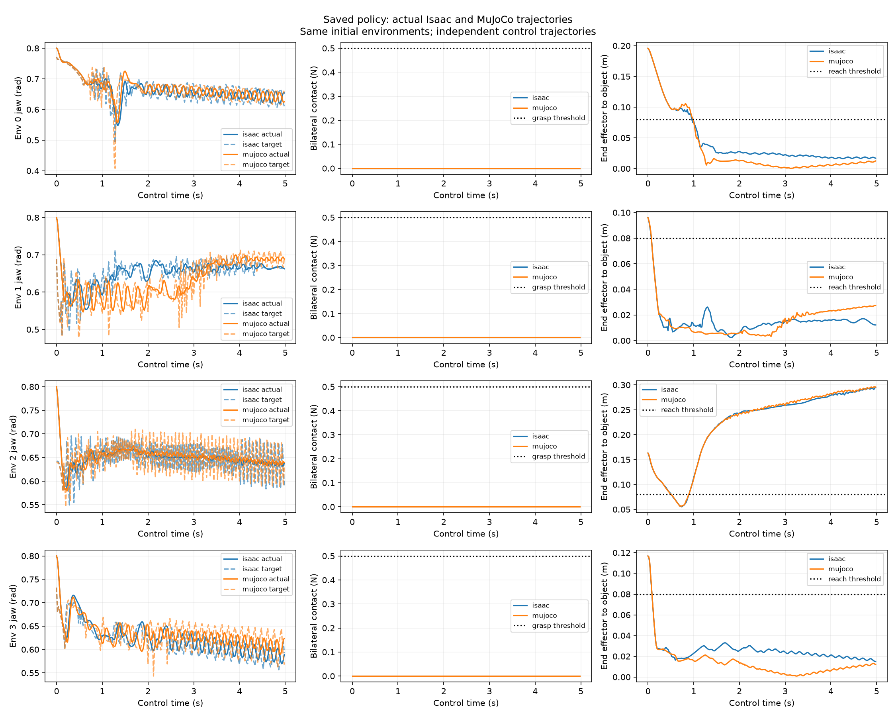

# sim2sim 轨迹诊断与完整 CPU 验证

对应源码为 `04f3bfb840cfad5b34e303e6170ec891dc4b99ae`，实际执行 receipt 使用同一提交。统一 CPU 流程通过全部 22 个阶段；实际执行的 377 个文件与源码提交逐项匹配。独立 CI `38163465861` 的 CPU 和 build 工作全部通过，实际 CI wheel 的 202 个模块与执行文件逐项匹配。

原始报告保存在 `suite.json` 和各阶段目录，报告、CI、实际 wheel 与曲线的 SHA256 保存于 `verification.json`。完整日志、数据、模型检查结果和独立进程检查保存在 `outputs/rl_progress/sim2sim_diagnostics_20261011/`；来源模型与原始数据使用各报告记录的路径。

## 检查结果

| 检查 | 实际结果 |
|---|---|
| 完整 CPU 流程 | 22 个阶段通过，全部退出代码为零 |
| 源码与命令入口 | 336 个 Python 文件、202 个模块、946 处项目 import、23 个 Shell 文件 |
| 几何、文件与进程 | 85 项通过，错误、失败和跳过数量为零 |
| 终端、控制与配置 | 80 项通过，错误、失败和跳过数量为零 |
| 实际场景启动检查 | 28 项 API 参数检查、18 次独立进程检查 |
| HDF5 状态与 LeRobot 导出 | 实际 328 帧；同步与异步分别检查全部帧 |
| LeRobot 直接采集 | 同步与异步分别检查 336 帧和三个 episode |
| ACT 与 Diffusion | 完整 CPU forward、backward、checkpoint 与连续推理通过；IL 更新次数为零 |
| 资产、场景与 MP4 | 十个实际 bundle、静态几何与标定视频检查通过 |
| MuJoCo 策略 | 四个 episode、1,000 个控制步骤、20,000 个物理步骤；任务成功 0/4 |
| sim2sim 诊断 | 两个模拟器分别检查 1,000 帧；1,200 次原生姿态 forward kinematics 检查通过 |
| 诊断进程与文件保护 | 六项独立进程检查通过，实际来源和已有曲线保持一致 |
| 项目 GPU 进程 | 查询结果为空 |

## 实际保存策略

四个环境的初始关节位置与物体位置一致。MuJoCo 中的 raw action 与保存关节目标转换误差为零；对应 Isaac 首个 episode 的最大动作转换误差为 `1.0132789611816406e-6 rad`，符合原始导出的数值容差。

两个模拟器均未记录双侧抓取接触。Isaac 的四个首个 episode 中，夹爪目标最小值依次为 `0.4911`、`0.4824`、`0.5495` 和 `0.5566 rad`；MuJoCo 对应最小值为 `0.4078`、`0.4782`、`0.5457` 和 `0.5432 rad`。逐关节控制误差和实际接触力保存在 `mujoco_diagnostics/diagnostics/report.json`。

横坐标使用两个模拟器各自的实际控制时间。曲线保留相同初始环境之后的独立策略轨迹。

GPU 和训练保持停止，九项原生验收尚未执行。动力学等价、成功策略迁移、人工键盘采集、真实视频恢复和真机任务分别保留对应验收状态。
